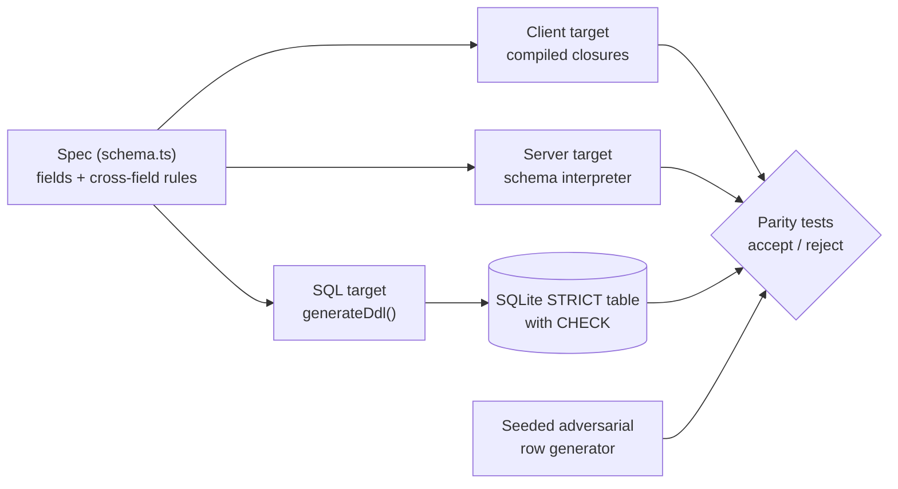

# onespec

One schema, three enforcement points: a compiled client validator, an interpreted server validator and SQL `CHECK` constraints, all generated from the same spec and proven to agree by a property-based parity suite.

[](https://github.com/SlateGitOrg/onespec/actions/workflows/ci.yml)

## Why

A field is optional in the UI, required in the API and `NOT NULL` in the database, and users get a cryptic 500 on submit. The three definitions were written separately, at different times, and nothing in the build could notice they disagreed. onespec generates all three from a single spec and then tests, with thousands of adversarial inputs, that they accept and reject exactly the same rows.

## Features

- A small declarative spec: typed fields (`string`, `integer`, `number`, `boolean`) with `required`, `minLength`/`maxLength`, `minimum`/`maximum`, `pattern` and `enum`.
- Cross-field rules that survive all three targets: `requiredIf` (field required when another equals a value) and `lessThanOrEqual`.
- Three independent implementations of the same semantics, so agreement is evidence rather than tautology.
- SQL generation as a `STRICT` table with a single `CHECK`, run for real against SQLite (`node:sqlite`).
- A seeded adversarial row generator and a mutation test showing the parity check detects drift.
- No dependencies and no build step: TypeScript runs natively through Node type stripping.

## Architecture



`src/schema.ts` defines the spec types and the sample KYC onboarding spec. `src/targets.ts` holds the three targets. The client target compiles each field into closures once; the server target walks the spec on every call; the SQL target emits DDL and is exercised by inserting rows into an in-memory SQLite database. The tests in `tests/parity.test.ts` feed the same rows to all three.

## Quick start

Prerequisite: Node.js 22.18 or newer (24 recommended), which runs `.ts` files natively and includes `node:sqlite`. There is nothing to install.

```bash
git clone https://github.com/SlateGitOrg/onespec.git
cd onespec
npm test        # 11 tests, including 10,000-row three-way parity
npm run demo    # the side-by-side table below
```

## Usage

```ts
import { KYC } from './src/schema.ts';
import { compileClientValidator, validateOnServer, makeSqlValidator } from './src/targets.ts';

const client = compileClientValidator(KYC);
const sql = makeSqlValidator(KYC);

const row = { full_name: 'Bob Jones', country: 'US', age: 41 };
client(row);                 // { valid: false, errors: ['tax_id:requiredIf'] }
validateOnServer(KYC, row);  // same
sql(row).valid;              // false
```

`npm run demo` runs eight rows through all three targets (trimmed output):

```
  case                            client   server   sql      agree
  valid GB applicant              accept   accept   accept   yes
  US applicant, no tax id         reject   reject   reject   yes
  US applicant, tax id given      accept   accept   accept   yes
  age 17                          reject   reject   reject   yes
  malformed IBAN                  reject   reject   reject   yes
  income_low > income_high        reject   reject   reject   yes
  name sent as a number           reject   reject   reject   yes
  opt_in sent as 1, not true      reject   reject   reject   yes

  8/8 agree.
```

## How it works

- **Different mechanisms on purpose.** If all three targets were one function called three times, agreement would prove nothing. The client is compiled closures, the server is an interpreter and the SQL target is evaluated by a database engine.
- **Type errors short-circuit.** A value of the wrong type is reported as `field:type` and not range-checked, in both JavaScript targets, so their error sets match exactly.
- **Absent means absent.** `undefined`, `null` and the empty string are all treated as missing; constraint checks are skipped for them and `required`/`requiredIf` fail.
- **SQLite typing traps.** Columns are declared `ANY` inside a `STRICT` table and the real type is enforced with generated `typeof()` checks. A plain `TEXT` column would silently coerce `42` to `'42'` before the `CHECK` runs. Booleans are stored as the text `'true'`/`'false'` so they stay distinct from `1`/`0`, and integer checks test the value rather than the storage class because JavaScript numbers bind as `REAL`.
- **Patterns reach the database.** SQLite has no built-in `REGEXP`, so one is registered; dropping pattern constraints from SQL is the classic way a malformed IBAN gets in through a bulk import.
- **Error detail.** The database only reports that a constraint failed, so all three targets are compared on the accept/reject decision, and the two JavaScript targets are additionally compared on the exact error set.

## Testing

```bash
npm test
```

`tests/parity.test.ts` covers:

- 10,000 seeded rows, each a valid baseline with 0 to 3 adversarial mutations (boundary lengths, non-integers, wrong types, empty strings), asserting identical accept/reject across all three targets and that both outcomes are well represented.
- 2,000 rows asserting the client and server produce identical error sets.
- The `requiredIf` rule (including an empty-string tax id) and the `lessThanOrEqual` rule.
- A mutation test: changing a constraint in only one target is detected as a disagreement.
- A check that the generated DDL contains the expected constraints.

## Project layout

```
src/schema.ts            spec types and the sample KYC spec
src/targets.ts           client, server and SQL targets
src/demo.ts              side-by-side demo
tests/parity.test.ts     parity, rule and drift tests
docs/ARCHITECTURE.md     design notes
.github/workflows/ci.yml CI (Node 24, node --test)
```

## Limitations

- The SQL target is SQLite, used as the executable stand-in for a real database. The generated constraints use portable constructs, but PostgreSQL DDL is not emitted.
- The spec is a deliberately small JSON-Schema-like subset, not full JSON Schema; there is no nesting, arrays or `oneOf`.
- No form renderer or migration tooling is included.

## License

MIT — see [LICENSE](LICENSE).
