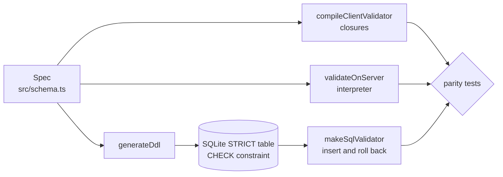

# Architecture

## Context

Validation rules for a form usually exist three times: in the client, in the API and as database constraints. They are written by different people at different times and drift apart, which shows up as a 500 when a row passes one layer and fails another. onespec makes one spec the source of truth and tests that every layer agrees.

## Container view

## Key decisions

- **Three genuinely different implementations.** A compiled closure, an interpreter and a database engine. The cost is three code paths to keep semantically aligned; the benefit is that the parity test is a real check and not the same function compared with itself.
- **Compare accept/reject across all three, error sets across two.** A database cannot say which constraint failed, so SQL participates in the decision comparison only. The JavaScript targets also agree on exact, sorted error codes.
- **Mutate a valid baseline for the property test.** Generating every field from an adversarial pool makes nearly every row invalid, so the accept path would never be exercised. Starting from a valid row and applying up to three mutations keeps both outcomes represented, and the test asserts that.
- **`STRICT` table with `ANY` columns.** SQLite column affinity coerces values before `CHECK` runs. Declaring `ANY` and enforcing types with `typeof()` makes the database see what was actually bound.
- **Booleans as text in SQL.** SQLite has no boolean type; encoding `true` as `1` would make it indistinguishable from the integer `1`, which the other targets reject.
- **Mutation test for drift.** Regenerating only one target after a schema change must produce a disagreement, which shows the parity assertion can detect drift.

## Failure modes

- Spec change applied to only some targets: parity tests fail with the first few offending rows printed.
- A new constraint kind added to one target but not the others: the generated rows that exercise it expose the disagreement.
- Wrong-typed input (a number in a text field, `1` for a boolean): rejected by all three, covered by the demo and the parity suite.

## Out of scope

- Full JSON Schema (nesting, arrays, `oneOf`), form rendering and migration tooling.
- PostgreSQL DDL emission; SQLite stands in as the executable database.
